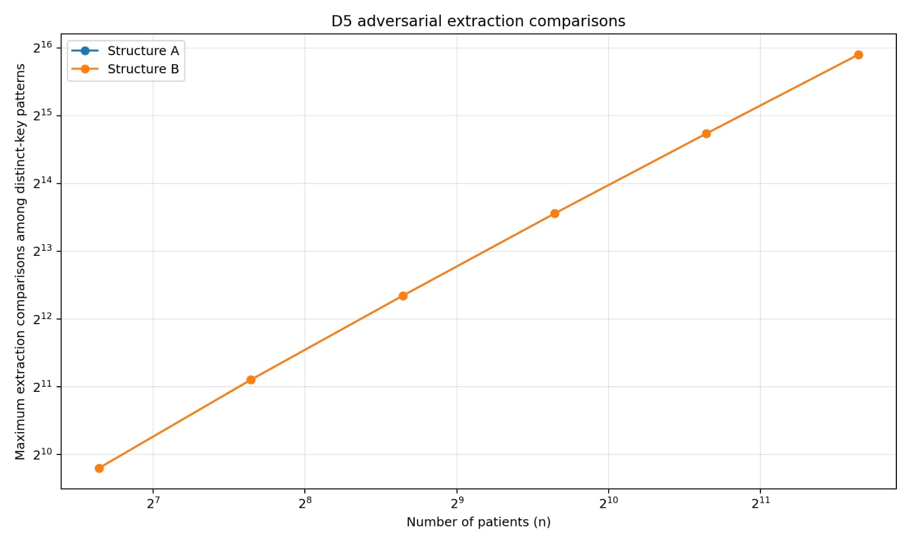

# Project 10 — D5 Adversary Report

## 1. Role and objective

D5 constructs inputs that expose expensive priority-queue behaviour, proves the required comparison lower bound, and measures the extraction behaviour of the team's two heap implementations.

The work has two separate parts: (1) a worst-case existence proof, and (2) experiments on the submitted implementations. The experiments identify the hardest pattern among the tested candidates; they do not prove that this pattern is the universal worst case.

## 2. Mathematical lower-bound proof

Assume a comparison-based binary min-heap supports:

- `build_heap` in `O(n)` comparisons;
- repeated `extract_min`;
- extraction returns the minimum remaining key.

Suppose, for contradiction, that every input of `n` distinct keys could be built into a heap and completely extracted using `o(n log n)` comparisons during extraction. We could then sort any array of `n` distinct keys by building the heap in `O(n)` comparisons and extracting all `n` keys in sorted order. The total would be `O(n) + o(n log n) = o(n log n)`, contradicting the comparison-sorting lower bound of `Omega(n log n)`.

Therefore, for every such comparison-based heap implementation, there exists an input of `n` distinct keys for which all `n` `extract_min` operations perform `Omega(n log n)` comparisons in total.

This is an existence proof. It does not identify one permutation that is worst-case for every implementation, and it does not claim every input is expensive. It applies to the binary-heap extraction process under the stated comparison model and linear-build assumption. The unsorted-array Oracle has a separate `Theta(n^2)` extraction count.

## 3. Input generator

`Adversary.cpp` is a standalone C++17 generator. It writes the four fields required by the project `Patient` model:

`id,severity,arrival_time,priority_key`

The generator supports seven candidate patterns:

| Pattern | Purpose |
|---|---|
| `ascending` | Increasing priority ranks |
| `descending` | Decreasing priority ranks |
| `alternating` | Alternates low and high ranks |
| `sawtooth` | Repeated local rises and falls |
| `bit-reversal` | Reorders ranks using reversed binary index bits |
| `random` | Seeded random permutation of distinct ranks |
| `equal-reverse-arrival` | Equal priority keys with reverse arrival order to stress tie-breaking |

All generated records have unique patient IDs. For the first six patterns, the priority keys are distinct. `equal-reverse-arrival` intentionally uses equal priority keys and is a tie-breaking stress case, not a distinct-key lower-bound input.

## 4. Benchmark implementation and counting method

`D5_HeapBenchmark.cpp` reads the generated four-column CSV, builds one selected heap, and extracts every patient. It checks that extracted priority keys are nondecreasing. The benchmark reports build comparisons and extraction comparisons separately.

Comparison instrumentation is enabled only for the D5 benchmark build using `D5_COUNT_COMPARISONS`; without this macro, the team's queue implementations retain their normal behaviour. Structure A increments the counter at each priority-key comparison. Structure B increments it once per `comes_before` comparator invocation. For the distinct-key patterns, each invocation resolves using the priority key, so these counts are directly comparable. The equal-key tie-breaking case is reported as a stress case and should not be used to claim exact primitive-field comparison equivalence between the structures.

The benchmark does not count hash-table probes, loop iterations, swaps, or memory operations as key comparisons. The measurements cover a static build-then-extract workload: no arrivals, updates, deletions, or aging occur during extraction.

## 5. Experimental setup

The experiment script `run_experiments.py` compiles the generator and both benchmark variants, creates each input, runs both heaps, and writes machine-readable CSV results.

- Compiler: GCC 14.2.0
- Language standard: C++17
- Optimization: `-O2`
- Warnings: `-Wall -Wextra -pedantic`
- Platform used for the recorded run: Linux x86_64
- Input sizes: `100, 200, 400, 800, 1600, 3200`
- Deterministic-pattern seed: `12345`
- Random seeds: `12345, 2026, 7`
- Total observations: 108 (54 input cases for each of two structures)

The normalized comparison ratio is

`R(n) = extraction_comparisons / (n * log2(n))`.

The full measurements are in `results/d5_experiment_results.csv`. The aggregate pattern ranking is in `results/d5_worst_patterns.csv`.

## 6. Experimental results

### Highest-count pattern at each input size

| n | Structure A pattern | A comparisons | A ratio | Structure B pattern | B comparisons | B ratio |
|---:|---|---:|---:|---|---:|---:|
| 100 | descending | 891 | 1.341089 | descending | 891 | 1.341089 |
| 200 | descending | 2,199 | 1.438410 | descending | 2,199 | 1.438410 |
| 400 | descending | 5,198 | 1.503380 | descending | 5,198 | 1.503380 |
| 800 | descending | 12,055 | 1.562523 | descending | 12,055 | 1.562523 |
| 1,600 | descending | 27,334 | 1.605034 | descending | 27,334 | 1.605034 |
| 3,200 | descending | 61,235 | 1.643436 | descending | 61,235 | 1.643436 |

For both implementations, `descending` produced the highest extraction-comparison count among the tested patterns at every tested size. The normalized ratio increased from about 1.34 to 1.64 over the tested range, consistent with extraction work growing on the `n log n` scale for this input family.

The two structures produced identical counts in these tests. This is an empirical observation for the current implementations and tested input families; it is not a claim that their internal designs are identical or that their counts will always match. The `equal-reverse-arrival` case is a tie-handling stress test and is not part of the distinct-key proof evidence.

### Interpretation and limitations

- The experiment supports `descending` as the strongest tested candidate for the current versions of Structure A and Structure B.
- The lower-bound proof establishes that a hard distinct-key input exists; finite experiments cannot prove that the tested descending pattern is the true worst case for all sizes.
- The benchmark measures key-comparator work only. It does not measure wall-clock runtime or peak memory, so no memory-performance claim is made.
- Results depend on the submitted queue implementations, compiler, and benchmark setup. Re-run the script after any queue changes.
- The aggregate pattern ranking uses the average extraction-comparison count across the tested input sizes and seeds. This avoids giving the random pattern an artificial advantage because it uses three seeds while the deterministic patterns use one seed. The per-size results are used to identify the strongest tested pattern at each input size.

## 7. Oracle baseline

The supplied unsorted-array Oracle scans the remaining vector to find the minimum. With `n` patients and all `n` extracted, it makes

`(n-1) + (n-2) + ... + 1 = n(n-1)/2 = Theta(n^2)`

calls to its comparator, assuming no insertions or deletions during the test. This is a separate baseline and is not used as the binary-heap lower-bound proof.

## 8. How to reproduce

From the repository root, with Python 3 and `g++` available:

```bash
python adversary/run_experiments.py
```

The default command runs all six sizes and three random seeds. To choose a smaller or different run:

```bash
python adversary/run_experiments.py --sizes 100,200,400 --seeds 12345,2026
```

The script writes:

- `results/d5_experiment_results.csv` — every Structure A and B measurement;
- `results/d5_worst_patterns.csv` — aggregate pattern ranking by structure.

To compile only the generator manually:

```bash
g++ -std=c++17 -O2 -Wall -Wextra -pedantic adversary/Adversary.cpp -o adversary/adversary
```

The experiment runner performs the required benchmark compilation automatically. On Windows PowerShell, run the Python command from the repository root; make sure `python` and `g++` are on PATH.

## 9. D5 deliverables

- Mathematical `Omega(n log n)` extraction lower-bound proof.
- Seven deterministic/reproducible candidate input patterns.
- CSV generator compatible with the project's four-field `Patient` structure.
- Working benchmark variants for Structure A and Structure B.
- Optional compile-time comparison instrumentation that does not change queue semantics.
- Automated experiment runner and raw CSV results.
- Measured pattern comparison and interpretation.

**Conclusion:** The D5 adversary contribution is implemented and experimentally evaluated for the current repository snapshot. Among the tested candidates and sizes, descending priority order is the strongest observed input for both heap implementations. The mathematical proof independently guarantees the existence of an `Omega(n log n)` extraction input for comparison-based binary heaps with linear-time build.

### Comparison-growth plot

The plotted series shows the maximum measured extraction-comparison count among the six distinct-key patterns for each size. The chart is saved as `results/d5_comparison_plot.png`.

 adversary



 main
